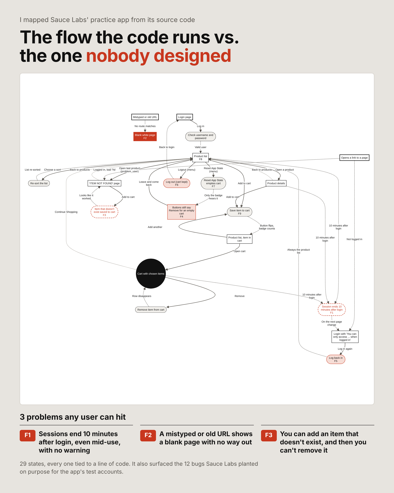

# frictionmap

**Find where people get stuck in your app, by reading its code.**

## The problem

Every app has a picture of how it's supposed to work: designs, mockups, flowcharts. But those pictures go out of date, and they usually show only the happy path, where everything goes right.

The code is different. The code is what actually runs. Every path a person can take is in there, including the messy ones: the error nobody designed a screen for, the button that spins forever, the page you can't get out of.

## Why I built this

I'm a product manager. When I need to understand how part of an app really works, the designs are often old, missing, or too tidy. So I read the code, because it's the only place that tells the truth. It works, but it takes days.

frictionmap does that reading for you.

## How it works

1. **Pick one journey**, like "sign up" or "reset my password".
2. **An AI agent reads the code.** It lists every screen a person can see, and every step happening behind the scenes.
3. **It draws the map.** Every screen and every arrow points to the exact line of code it came from, so anyone can check it.
4. **It looks for trouble spots:**
   - **Dead ends:** nothing on screen lets you move forward
   - **Endless loading:** a spinner or frozen screen that never finishes
   - **Ghost states:** something happened behind the scenes, but the screen doesn't show it
   - **Silent failures:** something went wrong, and nobody tells you
   - **Lost progress:** you have to redo steps you already finished
5. **You get a report:** the map, the problems from worst to least bad, and a suggested fix for each.

## Does it work? A test with an answer key

SauceDemo is a practice shopping app that Sauce Labs built for testing. Its makers hid bugs in it on purpose for special test accounts, so it comes with an answer key.

frictionmap mapped login, browsing and the cart: 29 screens and behind-the-scenes steps. It found:

- **The 12 hidden bugs**, each tied to the line of code that causes it.
- **3 problems any user could hit**, outside the hidden ones:
  1. You're logged out 10 minutes after logging in, even mid-use. The message makes it sound like your fault.
  2. Type a wrong web address and you get a blank white page with no way back.
  3. You can add a product that doesn't exist to your cart. The cart counts it, but you can't see it or remove it.

None of these show up in a design, because no screen exists for them.

Full report: [example-saucedemo-report.html](example-saucedemo-report.html) (download it and open it in a browser; GitHub shows it as code). The map itself: [example-saucedemo-flow.json](example-saucedemo-flow.json).

## Try it on your own project

Use it on the app you work on, or a side project. Anything you have the code for.

1. Download this repo and put the folder in your AI agent's skills folder. For Claude Code, that's `~/.claude/skills/frictionmap`.
2. Open your project and ask for the journey you want mapped:
   - *"Map our sign-up flow and find where people get stuck."*
   - *"Map how a user resets their password."*
   - *"Map inviting a teammate, from the email to their first login."*

   One journey at a time works best. Saying where it ends ("until they reach the dashboard") makes the results sharper.

You don't need the app running, just the code. If your code is on GitHub, you can point to it instead: *"Clone github.com/your-org/your-repo and map the onboarding flow."*

The agent follows [SKILL.md](SKILL.md). A small Python script, [analyze.py](analyze.py), checks every code reference and builds the report. It needs nothing installed beyond Python.

## Good to know

- **It reads code; it doesn't run your app.** It can tell you what *can* happen, not how often.
- **It's only as good as its reading.** That's why every claim links to a line of code, and the script rejects claims without one.
- **Private code?** Share the report, not the code. Reports list file names and line numbers, never the code itself.

## For the curious

- [checks.md](checks.md): every check, and how severity is decided
- [schema.md](schema.md): the format of the map file

## License

MIT: free to use, change and share.
